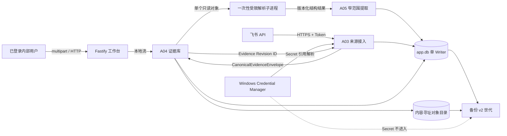

# ADR-0004：第二阶段来源、证据与解析威胁模型

## Status

Accepted by user

## Date

2026-08-20

## Context

第二阶段让 Agent Voucher 第一次接触原始财务资料和外部飞书 API。新增数据包括银行流水、发票、合同、审批表单、附件、Connector Secret 和结构化修订历史。现有第一阶段是 Windows 10 22H2 目标主机上的 Node.js 24 模块化单体，使用单 Writer SQLite、Fastify/HTMX、默认 localhost 和显式 LAN HTTP。

数据库事务不能原子覆盖对象文件系统、飞书 API 和 Windows Credential Manager。XLS/XLSX/PDF 也属于复杂、不可信输入，不能在拥有数据库和 Secret 的 Web 进程中直接解析。备份若只包含 SQLite 会丢失 Evidence，若包含 Secret 又会扩大泄露面。

用户明确接受两个延期风险：局域网模式继续使用未加密 HTTP；正式原件和备份暂不做应用级静态加密。这些决定不等于风险已经消除。

## Assets and trust boundaries

需要保护的资产：

- Windows Credential Manager 中的飞书 App Secret；
- 飞书 Tenant Token 和临时 Page Token；
- 原始银行、发票、合同和审批资料；
- Evidence 来源链、Revision、Tombstone、Mapping 和人工修改理由；
- `app.db`、`graph.db`、内容对象和备份 Manifest 的完整性；
- 用户 Session、角色和不可变审计。

信任边界：



在 `--lan` 模式中，用户浏览器到 Web 的边界没有传输加密；拥有主机账户、磁盘或备份介质读取权限的人也能读取未加密财务原件。这两项是接受风险，不是受信边界内部的安全保证。

## Decision

### 1. 平台与模块 DAG

- 第二阶段正式平台冻结为 Windows 10 22H2 和 Node.js 24；不支持的 Node 主版本必须在启动、测试和安装前置检查中拒绝；
- 模块依赖固定为 `A03 Source → A04 Evidence → A05 Structured Extraction`；
- 表所有权固定为 A03 `conn_`/`src_`、A04 `evd_`、窄范围 A05 `doc_`，继续复用 A01/A02 的 Port 与单 Writer；
- A03 不直接写对象目录，A04 不解释飞书业务结构，A05 不反向修改来源或 Evidence；
- 模块迁移以 `MigrationManifest` 声明版本、依赖、校验和和升级 SQL；未知新版、漂移或中断时 fail closed；
- A02 的 `JobHandlerRegistry` 只运行通用租约、心跳、取消和重试，业务处理器由组合根注册，任务 Payload 只存 ID 和小型参数。

### 2. 跨边界提交与重放

不实现伪分布式事务。每个模块持久化自己的状态，并以外部 ID、远端 Revision、幂等键和内容 Hash 安全重放：

```text
A03: DISCOVERED → FETCHING → ARCHIVED | PARTIAL | REAUTH_REQUIRED | FAILED
A04: STAGING → STORED | PHYSICAL_DUPLICATE | QUARANTINED
A05: QUEUED → PARSED → VALIDATED | NEEDS_REVIEW | OVERRIDDEN_UNREVIEWED | FAILED
```

A03 仅在 A04 返回已经持久化的 Evidence Revision ID 后完成条目。崩溃留下的暂存文件、半归档条目和孤立状态由启动对账或后台任务重试/隔离；不得以删除历史事实来“修复”不一致。

### 3. Evidence 内容存储

- 上传和远端附件均流式进入同卷随机暂存文件，同时计算 SHA-256、大小和实际类型；
- 校验通过后按 Hash 分层路径原子发布；用户文件名只作为脱敏元数据，不参与服务端路径；
- 相同 Hash 共用一个只读物理对象，每次接收仍新增独立 Import Occurrence；
- Evidence 和用户修订只追加 Revision，远端撤回或删除新增 Tombstone；
- 正式对象本阶段不执行 GC；隔离对象进入独立命名空间并默认 7 天清理；
- 下载只允许已鉴权角色，以附件、`nosniff` 和安全文件名响应，不内联执行文档内容。

### 4. 不可信解析

- XLS/XLSX 和 PDF 使用一次性 Node.js 子进程，而不是拥有数据库/Secret 的 Web 进程或普通 Worker；
- 父进程清除业务环境变量，只传一个临时只读文件和解析配置；
- Node.js 24 Permission Model 只允许所需读取和运行资源，并禁止写文件、派生子进程、Worker 和原生扩展；
- 父进程执行 60 秒、256 MiB、50 MiB、银行 100,000 行和 PDF 500 页上限；异常退出、超时和 OOM 只使解析失败，不删除 Evidence；
- 公式、宏、外部链接、嵌入对象和压缩异常不成为可信会计值；
- Permission Model 只提供纵深防御，不视为针对恶意输入的 OS 级沙箱。试点只允许已登录内部用户和官方飞书附件。

### 5. 飞书与 Secret

- App Secret 存 Windows Credential Manager，SQLite 仅保存 `secret_ref`；Tenant Token 只存在于必要的短生命周期内存；
- 日志、审计、任务、Graph、错误响应和备份不得保存 Secret、Token、Page Token 或审批正文；
- 发现只接收 `APPROVED`，但已追踪实例必须跨状态复核，以 Tombstone 表达 `CANCELED`、`REVERTED` 或删除；
- 使用持久高水位加 48 小时重叠；Page Token 可用于单次恢复，高水位仅在整页终态后推进；
- 401/403 转 `REAUTH_REQUIRED`，429 遵守 `Retry-After`，5xx 和超时有限重试；
- 恢复数据库后重新解析 `secret_ref`，缺失时 fail closed 到 `REAUTH_REQUIRED`。

### 6. 备份恢复 v2

- 先快照 `app.db`，从快照枚举所有历史 Evidence/Tombstone 引用的 Hash；
- 复制并逐个校验对象，再快照 `graph.db`；
- 最后原子发布含 Generation ID、数据库 Hash 和对象清单的 Manifest；未发布 Manifest 的目录不是有效备份；
- 隔离对象和 Credential Manager Secret 不进入备份；
- 恢复在新目录完成 Manifest、Schema、SQLite 完整性、Graph 和全部对象 Hash 验证后，才执行同卷目录交换；
- 失败时回滚并保留恢复前副本；恢复后检查 Secret 引用和运行 Doctor。

### 7. 接受风险的控制

LAN HTTP 沿用 ADR-0003：默认 localhost，只有 `--lan` 显式开启；终端、登录页和所有已登录页面持续提示同网段可监听、只能用于受信隔离网络、不得端口映射或公网暴露。

无静态加密沿用以下补偿控制：Windows 账户和文件 ACL 限制访问；数据目录拒绝符号链接/共享盘；Secret 永不进入对象或备份；备份 UI 和文档明确介质可直接读取财务资料。任何面向不受信主机、多租户、丢失设备或外部备份的部署必须先以新 ADR 引入加密和密钥管理。

## Threat analysis

| Threat | Required control | Residual risk |
|---|---|---|
| 路径穿越、覆盖和符号链接逃逸 | 随机同卷暂存、真实路径校验、内容寻址、原子发布 | 有本机写权限的恶意进程仍超出应用边界 |
| MIME 伪造、宏、脚本和解析器漏洞 | Magic/type 检测、隔离、受限子进程、资源上限、不内联执行 | Permission Model 不是完整沙箱 |
| 重复提交或崩溃重放 | 外部 ID、远端 Revision、幂等键、Hash、独立 Occurrence | 业务意义上的重复交易仍需未来人工匹配 |
| 飞书撤回遗漏 | 48 小时重叠、跨状态复核、Tombstone | Provider 行为或权限变化需真实环境验证 |
| Secret/Token 落盘 | Credential Manager、引用存储、脱敏规则和泄露扫描 | 运行中主机完全失陷不在应用可防范围 |
| 备份成功但 Evidence 缺失 | 快照驱动对象清单、逐对象 Hash、Manifest 最后发布 | 介质本身仍未加密 |
| 未授权查看或修订 | Session、CSRF、角色、Revision CAS、审计、安全下载 | LAN HTTP 可泄露会话和内容 |
| 金额精度错误 | CNY 整数分、余额与合计确定性校验 | 原始资料错误可被带理由覆盖但会明确标记 |

## Alternatives Considered

### 把文件存入 SQLite BLOB

拒绝。它简化单事务和备份，但会放大数据库、迁移、并发和恢复成本，并让大文件读写占用单 Writer。内容寻址对象配合世代 Manifest 更适合当前容量和不可变模型。

### 在 Web 进程或 Worker Thread 中解析

拒绝。Worker Thread 与主进程共享 OS 身份和大部分能力，无法成为处理复杂文档的可信隔离边界；一次性受限子进程可以实施更清晰的环境、文件、时间和内存限制。

### 把飞书 Secret 加密后存 SQLite

拒绝。应用仍需在同一主机持有解密密钥，且 Secret 会随数据库/备份复制。Windows Credential Manager 更符合单主机试点的 Secret 生命周期。

### 本阶段强制 HTTPS 和应用级静态加密

延期。它们会引入证书、密钥恢复、轮换和 Windows 部署复杂度；用户已明确接受当前残余风险。该选择只适用于受信隔离 LAN 和受控 Windows 主机，不构成未来安全设计的先例。

## Consequences

- 正面：原件、来源、修订和备份拥有可验证的完整链路；重复、崩溃和 Provider 重试可安全收敛；
- 正面：Secret 与备份分离，不可信解析不拥有数据库或外部凭据；
- 负面：对象目录与 SQLite 需要显式对账和世代恢复协议；
- 负面：恢复后可能需要管理员重新输入飞书 Secret；
- 负面：LAN 和静态数据仍存在用户已接受但实质性的泄露风险；
- 中性：未来 HTTPS、静态加密、OS 级沙箱或对象 GC 必须用新 ADR 扩展或替代本决定。
