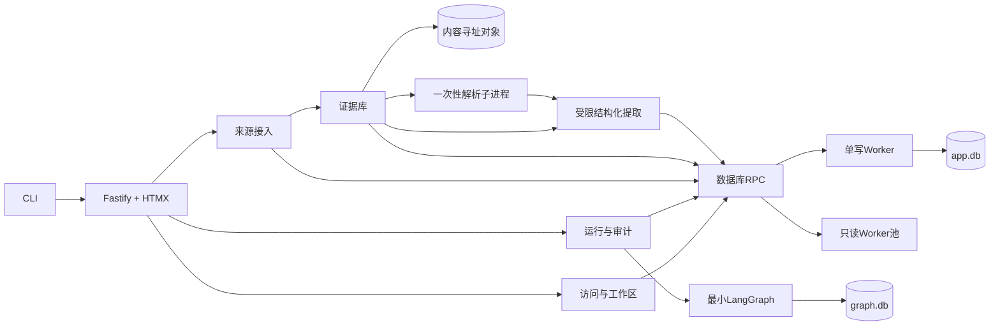

# Agent Voucher 第二阶段目标架构

当前产品范围与验收以 [`PRD.md`](PRD.md) 为准；本文件记录第二阶段的目标架构和技术边界，不代表所有组件已实现。详细数据流和威胁模型见 [ADR-0004](adr/0004-phase2-source-evidence-threat-model.md)。

## 决策

继续采用 Node.js 24 模块化单体：Fastify 负责 HTTP，业务模块只通过版本化 Port 访问能力与数据库 RPC；一个写 Worker 串行写入，两个只读 Worker 处理查询，最小 LangGraph 运行时使用独立 `graph.db`。文档解析在一次性受限子进程运行，不把不可信 XLS/PDF 带入拥有数据库和 Secret 的 Web 进程。

## 非功能目标

- 5个并发用户；读取p95小于500ms，短写p95小于1秒。
- 单数据目录只运行一个实例。
- 写事务不包含网络、模型或文件处理。
- 银行解析单文件最多 100,000 行，PDF 最多 500 页；解析子进程最长 60 秒、内存上限 256 MiB。
- 备份 v2 必须覆盖 `app.db`、`graph.db` 和快照引用的全部 Evidence 对象；Manifest 最后原子发布，恢复前验证每个 Hash。
- LAN HTTP是用户明确接受的阶段性风险，默认仍只监听localhost。
- 原件和备份不做应用级静态加密是用户明确接受的延期风险；Secret 不进入二者。

## 模块所有权

| 模块 | 表前缀 | 允许职责 |
|---|---|---|
| A01 Access & Workspace | `iam_`, `cfg_`, `mst_` | 用户、角色、会话、工作区、期间、主数据 |
| A02 Runtime & Audit | `job_`, `prc_`, `aud_`, `ops_` | Job、流程、审计、备份、恢复 |
| A03 Source Ingestion | `conn_`, `src_` | 飞书连接、游标、远端实例、同步批次 |
| A04 Evidence Vault | `evd_` | Import Occurrence、Evidence Revision、对象索引、隔离、Tombstone |
| A05 Structured Extraction（窄范围） | `doc_` | 银行 Mapping/行 Revision、发票字段 Revision、确定性校验 |

依赖方向为 `A03 → A04 → A05`；禁止跨模块直接 SQL、ORM 关系、内部 Repository 复用和反向导入。A02 通过 Handler Registry 承载通用任务运行时，不导入 A03–A05。Graph checkpoint 不是业务、证据或审计事实。
